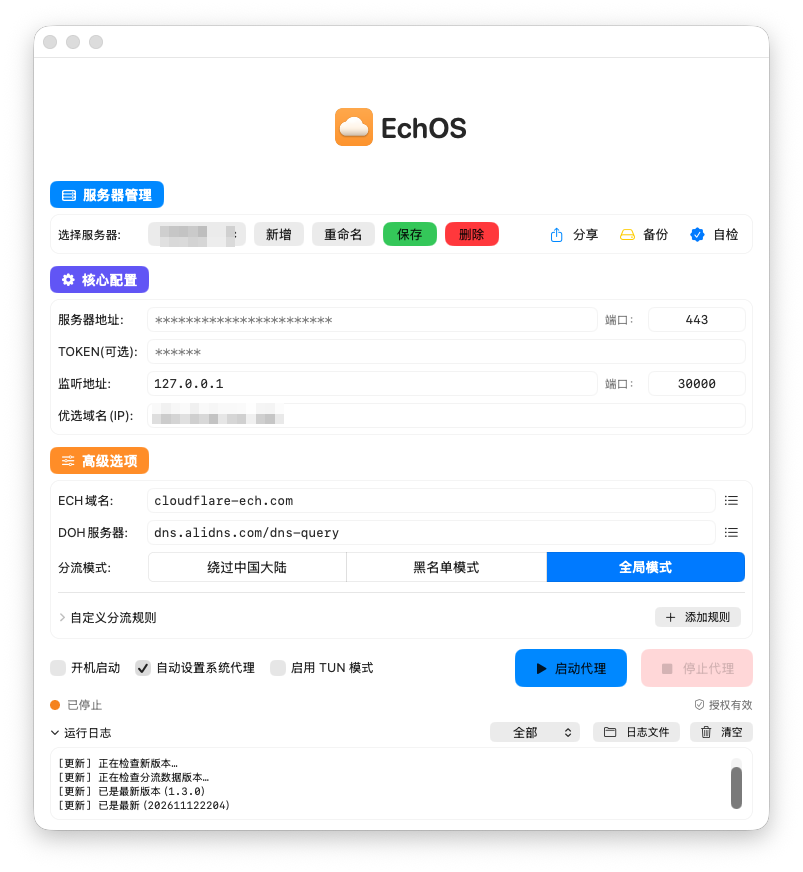
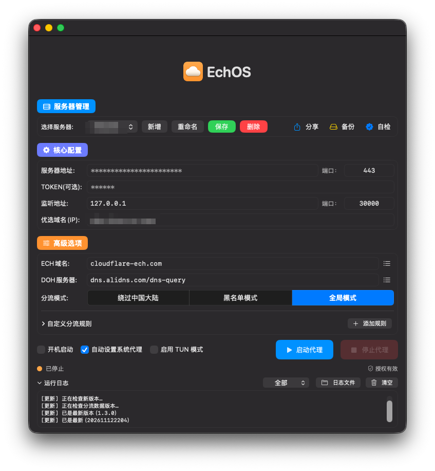

# EchOS

基于 **ECH（Encrypted Client Hello）** 的加密代理客户端，macOS 原生应用。

**Go 内核 + SwiftUI 界面**，一个 App 完成代理全部功能，不需要额外装 v2rayN / ClashX。
服务端跑在 Cloudflare Workers 上，免费额度足够个人日常使用。

---

## 界面预览

浅色 / 深色自动适配，跟随 macOS 系统外观自动切换，无需手动设置：

| 浅色 | 深色 |
|---|---|
|  |  |

> 多服务器管理、核心配置、分流规则、运行日志都在一个窗口里。

---

## 功能特性

- **ECH 加密隧道** — 基于 TLS ECH 的代理协议，抗 DPI 检测
- **SOCKS5 + HTTP 双协议本地代理** — 自动分配端口，HTTP 端口自动 +1
- **系统代理一键接管** — 启动即接管（自检通过后生效），停止自动还原；默认路由在 VPN 时自动跳过，不抢流量
- **三种分流模式（App 级）** — 绕过中国大陆 / 黑名单 / 全局；支持域名、IP 段、网站分类自定义规则
- **多服务器管理** — 运行中切换服务器、参数校验、未保存改动保护
- **整配置备份** — 本地文件 / WebDAV；服务器可分享导出/导入
- **连通性自检** — 未启动预检（服务器地址 + Token 鉴权），运行中多站点探测
- **自动检查更新** — 发现新版本自动下载 DMG 并替换重启；分流数据随上游更新
- **TUN 模式** — 接管全量路由的系统级代理（gVisor 用户态协议栈，DNS 劫持 + 分流；需管理员权限）
- **菜单栏常驻 + 程序坞图标开关 + 开机自启**

---

## 系统要求

- macOS 13.0+，Intel 或 Apple Silicon（通用二进制）
- 无 Apple 开发者签名，首次打开需**右键 → 打开**绕过 Gatekeeper

---

## 快速开始

1. 打开 DMG，将 `EchOS.app` 拖入 `Applications`
2. 首次启动弹出「新建服务器名称」，填好服务器配置 → 保存 → 启动代理

| 字段 | 说明 | 示例 |
|---|---|---|
| 服务地址 | Workers 域名（不含协议头） | `xxx.workers.dev` |
| 服务端口 | 连接端口 | `443` |
| 监听端口 | SOCKS5 端口，HTTP 自动 +1 | `30000` |
| 优选IP(域名) | Cloudflare 优选 IP，逗号分隔 | `104.16.158.132` |
| ECH域名 / DOH服务器 | 内置常用选项，直接选即可 | |
| TOKEN | 可选，与服务端 `TOKEN` 环境变量一致 | |

---

## Cloudflare 部署（服务端）

服务端是一个 Cloudflare Worker，仓库根目录的 `Worker-ECH.js` 就是完整代码。

> **必读**：Worker「兼容日期」必须设为 `Sep 15, 2025` 之前的日期，否则隧道数据不通。

```bash
npm install -g wrangler
wrangler login
TOKEN=你的密钥 ./deploy-worker.sh
```

部署后得到 `https://<你的名称>.workers.dev` 地址，填进客户端「服务地址」。

---

## 从源码构建

需要 Xcode 命令行工具（`swiftc`）和 Go 1.22+。

```bash
./fetch-geodata.sh   # 下载分流数据（geoip/geosite，不进仓库）
./build.sh           # 编译 App（通用二进制）
./make-dmg.sh        # 打包 DMG
```

---

## 开源说明

- 本项目基于 MIT 协议开源，详见 [LICENSE](LICENSE)
- **仅供学习交流使用，请勿用于商业用途；请在下载后 24 小时内删除**
- 请遵守所在地区法律法规；ECH 是加密传输技术，请勿用于任何非法用途
- 本项目不提供任何公共代理服务器，服务端需自行部署

---

## 致谢

- **CCF** — 客户端开发与整体方案设计（[CF_NAT](https://t.me/CF_NAT)）
- **byJoey** — 部分实现参考 [ech-wk](https://github.com/byJoey/ech-wk)
- **CM（CMLiussss）** — 优选 IP 方案（ProxyIP 定制优化）
